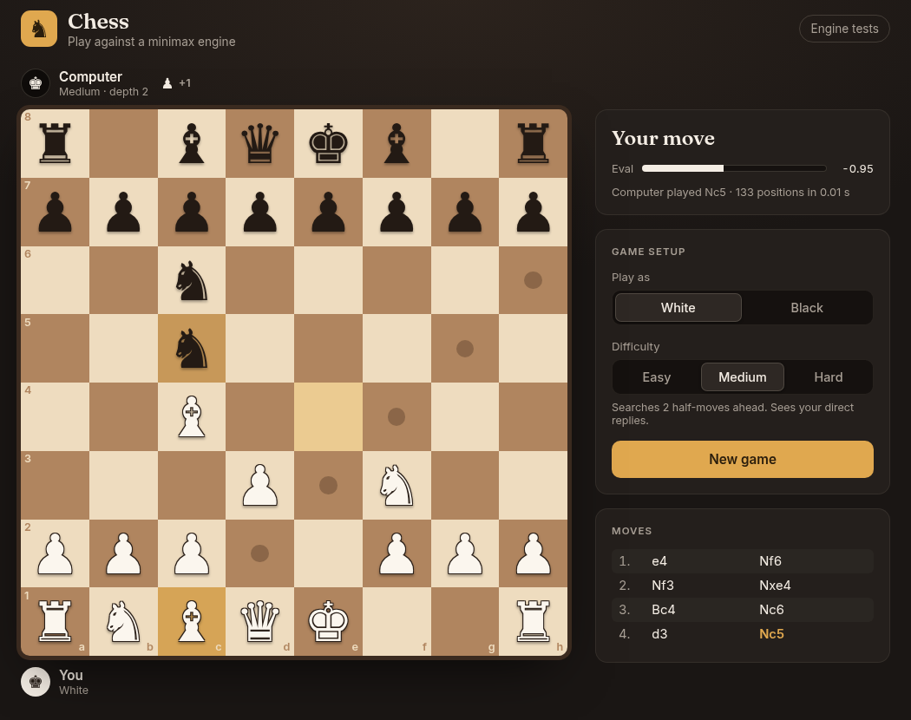
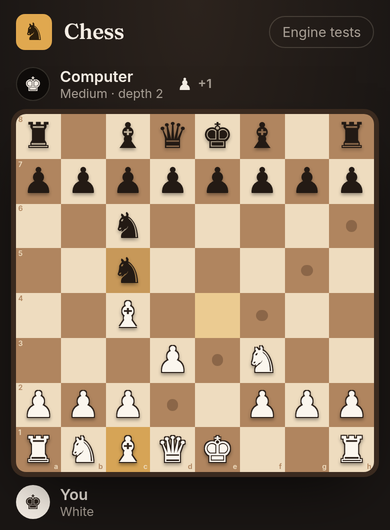

# Chess vs Computer

A browser chess game with a chess engine written from scratch: complete legal move generation, a position evaluator, and a minimax search with alpha-beta pruning that runs in a background thread. It uses plain HTML, CSS and JavaScript, with no libraries, frameworks or build step.

**[▶ Play it live](https://YOUR-USERNAME.github.io/chess-engine/)** · **[Run the engine tests](https://YOUR-USERNAME.github.io/chess-engine/tests.html)**

<p align="center">
  
  &nbsp;
  
</p>

## Features

- **All the rules of chess.** Legal moves for every piece, check, checkmate, stalemate, castling, en passant, and promotion with a piece picker.
- **A computer opponent** with three difficulty levels, based on how far ahead it searches.
- **Play either colour.** The board flips when you play Black and the computer moves first.
- **Click or drag.** Move with click-to-move or drag-and-drop, with mouse or touch.
- **Animations and feedback.** Pieces slide, captured pieces fade, the last move is highlighted, and the king glows in check.
- **Live information.** Moves are listed in standard chess notation (`Nf3`, `exd5`, `O-O`, `Qxf7#`). An evaluation bar and captured-piece counters update after each move, and a "thinking" indicator shows while the computer searches.
- **Works everywhere.** The layout adapts to phones and desktops.
- **Tested.** 44 automated tests run in the browser.

## How to play

1. Open the [live game](https://YOUR-USERNAME.github.io/chess-engine/).
2. Choose **Play as** White or Black, pick a **Difficulty**, and press **New game**.
3. Move a piece by clicking it and then a highlighted square, or by dragging it. A dot marks an empty square you can move to; a ring marks a piece you can capture.

| Level  | Search depth | Time per move (measured)              |
|--------|--------------|----------------------------------------|
| Easy   | 1 half-move  | under 0.01 s                           |
| Medium | 2 half-moves | about 0.01 s                           |
| Hard   | 4 half-moves | 0.24 s on average, 0.83 s at worst     |

The Hard timings come from a 60-half-move game the engine played against itself. Depth 5 sometimes took 9 seconds, so Hard stops at depth 4.

## How it works

### Move generation
The board is an 8×8 array, and each piece is a two-letter string such as `wN` (white knight). Moves are generated in two steps. First come the moves each piece's movement pattern allows. Then any move that would leave your own king in check is removed, by playing it on a copy of the board and testing whether the king is attacked. To test whether a square is attacked, the engine looks outward from that square for enemy pieces, instead of generating every enemy move.

### Perft verification
Perft counts every possible sequence of legal moves to a fixed depth. Those totals have been published for standard test positions, so a single wrong rule anywhere changes the count. The engine matches the published counts on five positions. These include the starting position (197,281 at depth 4) and positions built specifically to test castling, en passant and promotion.

### Evaluation with piece-square tables
A position is scored in centipawns (100 = one pawn), always from White's point of view: positive means White is better. The score adds up material (pawn 100, knight 320, bishop 330, rook 500, queen 900) plus a bonus or penalty for the square each piece stands on. For example, a central knight gets +20 and a knight in the corner gets −50. The king uses a different table in the endgame so it walks to the centre instead of hiding.

### Minimax with alpha-beta pruning
The engine looks ahead a fixed number of half-moves. It assumes White always picks the highest score and Black the lowest, and passes the scores back up the tree. Alpha-beta pruning stops examining a move as soon as it is proven worse than a move already found. The result is identical to plain minimax, which a test confirms, but much less of the tree is searched. Checkmate scores 100,000 minus the distance to mate, so the engine picks the fastest win and the slowest loss. Stalemate scores 0.

### Move ordering
Alpha-beta pruning cuts the most when the best moves are searched first. The engine searches captures first, ordered by "most valuable victim, least valuable attacker", so pawn-takes-queen is tried before queen-takes-pawn. On a sharp test position at depth 4, this cut the search from 553,303 positions to 6,881 (80× fewer), and the time from 5.19 s to 0.29 s.

### Web Worker
JavaScript normally runs on the same thread that draws the page, so a long search would freeze the screen. The search therefore runs in a Web Worker, a background thread that receives the position and sends back the chosen move. I measured the difference: a timer on the page kept ticking during a search with the Worker, and stalled without it.

## Testing

Open [`tests.html`](https://YOUR-USERNAME.github.io/chess-engine/tests.html) to run every test in your browser. All **44 pass**.

| Suite      | Tests | What it checks |
|------------|------:|----------------|
| Perft      | 17 | Move counts match published values on 5 positions, e.g. 20 / 400 / 8,902 / **197,281** from the start, and 48 / 2,039 / 97,862 on "Kiwipete" |
| Evaluation | 11 | The start position scores 0. A **mirror test**: flipping a position and swapping colours gives exactly the negative score |
| AI         | 10 | Alpha-beta gives the **same score as plain minimax**. It finds mate in one for both colours and prefers checkmate to stalemate |
| Notation   |  6 | Check `+`, mate `#`, castling, promotion, en passant, and telling identical pieces apart (`Nbd2`, `R1a3`) |

## Project structure

```
index.html          the game page
tests.html          runs all 44 tests in the browser
css/style.css       the Walnut theme and responsive layout
js/board.js         board representation, starting position, FEN loading
js/rules.js         move generation, check, checkmate, stalemate, special moves
js/evaluate.js      material + piece-square table evaluation
js/ai.js            minimax with alpha-beta pruning and move ordering
js/ai-worker.js     runs the search in a background thread
js/notation.js      standard algebraic notation for the move list
js/perft.js         perft counting and the reference positions
js/ui.js            drawing the board, animations, side panel
js/main.js          input (click and drag), game flow, talking to the AI
```

The rules, evaluation and search files never touch the page. They work only with data, which is why the AI can search thousands of positions without drawing any of them.

## Run it locally

You only need Python, which is already installed on most computers, to serve the folder:

```bash
python3 -m http.server 8000
```

Run that in the project folder, then open <http://localhost:8000>. Opening `index.html` by double-clicking also works, but browsers block Web Workers on `file://` pages, so the game falls back to searching on the main thread and briefly pauses while the computer thinks.

## Deploy on GitHub Pages

1. Push this folder to a GitHub repository.
2. In the repository, go to **Settings → Pages**.
3. Under **Build and deployment**, choose **Deploy from a branch**, then branch **main** and folder **/ (root)**, and click **Save**.
4. After a minute the game is live at `https://YOUR-USERNAME.github.io/REPOSITORY-NAME/`.

## About this project

I built this as a learning project while preparing to study Computer Science, working with an AI assistant (Claude). We built it in six stages: board, move rules, special moves and perft, evaluation, search, and interface. After each stage I studied how the code worked and why it was designed that way, and tested it, before going on to the next. I can explain every algorithm in it, from move generation to alpha-beta pruning.

## Credits

- Piece-square table values: Tomasz Michniewski's *Simplified Evaluation Function* ([Chess Programming Wiki](https://www.chessprogramming.org/Simplified_Evaluation_Function)).
- Perft reference positions and counts: [Chess Programming Wiki, Perft Results](https://www.chessprogramming.org/Perft_Results).
- Fonts: [Fraunces](https://fonts.google.com/specimen/Fraunces) and [Inter](https://fonts.google.com/specimen/Inter). Pieces are Unicode chess symbols.
